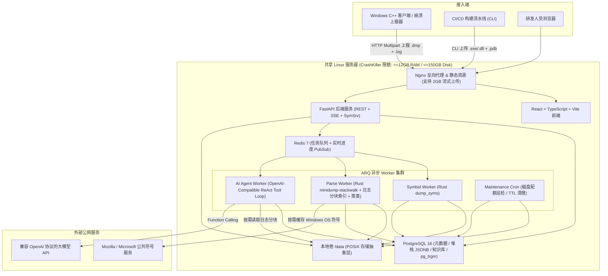
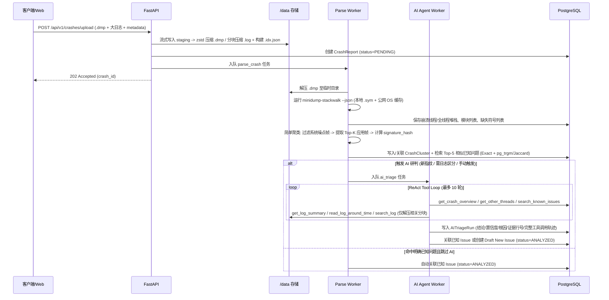
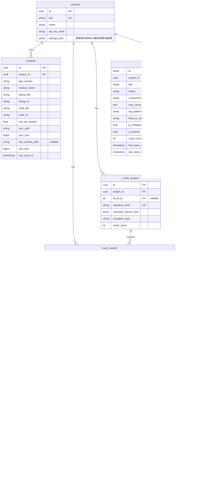

# CrashKiller 系统架构设计与实施计划

> **状态**：已确认架构方案，可直接用于研发 / `/teamwork` 分工实施。
>
> **已确认的核心约束与技术选型**：
> - **目标环境**：共享 Linux 服务器（高性能 CPU、64GB 内存、500GB 磁盘且同机运行其他服务、可访问公网）
> - **资源隔离**：CrashKiller 默认总磁盘硬上限 **150GB**（可动态调低）、宿主机剩余空间保护底线 **50GB**、Docker 容器总内存限额 **≤ 12GB**
> - **业务规模**：中小规模（几十~几百份/天，MiniDump 1~50MB，伴随大日志 10~200MB）
> - **符号策略**：同时接收 Windows `EXE/DLL` + `PDB`；Linux 原生通过 Rust `dump_syms` 转为 Breakpad `.sym` 去重长存；原始 PDB/EXE 按需可选归档并限制 **15GB LRU**；公网自动按需缓存 Windows OS 公共符号
> - **AI 接入**：兼容 OpenAI API 协议的外部/企业模型（可动态配置 Base URL / API Key / Model），默认 **Smart Triage** 智能触发模式
> - **技术栈**：Python 3.12 (FastAPI + SQLAlchemy 2 + Alembic + ARQ) + React (TypeScript + Vite + TailwindCSS) + PostgreSQL 16 (`pg_trgm`) + Redis 7 + Docker Compose + Rust `rust-minidump` (`minidump-stackwalk`) & `dump_syms`

---

## 目标描述 (Goal Description)

**CrashKiller** 是一套部署在共享 Linux 服务器上的 **Windows C++ 崩溃治理与智能归因平台**。系统在不影响同机其他程序的前提下，覆盖崩溃治理的完整闭环：

1. **符号表管理**：统一管理 Windows C++ 产物（`EXE/DLL` + `PDB`），在 Linux 原生转换为 Breakpad `.sym` 符号库，并自动缓存公网 Windows 系统符号。
2. **MiniDump 与大日志收集解析**：支持客户端/CI/Web 上报 `.dmp` 及伴随的 10MB~200MB 大日志文件，通过流式分块 `zstd` 压缩与索引，兼顾紧凑存储配额与毫秒级随机读取/检索。
3. **简单聚类 + AI Agent 智能研判**：先通过确定性栈指纹完成快速聚类与候选问题召回，再由具备日志检索工具的 AI Agent 综合堆栈、大日志上下文与历史问题知识库，判定崩溃属于 **已知问题（Known Issue）**、**新增问题（New Issue）**、**已修复回归（Regression）** 或 **需人工复核（Needs Review）**。
4. **全栈可视化与运维**：提供现代化的 React Web 控制台、实时分析进度、大日志虚拟滚动阅读器、符号缺失补传与重解析、以及磁盘配额可视化与自动清理。

---

## 已确认的关键架构决策 (Confirmed Architectural Decisions)

> [!IMPORTANT]
> **关键决策 1：源头 EXE/DLL 与 PDB 纳入符号表管理 —— 「同时接收，分层存储」**
> - **为什么必须支持同时提供 `EXE/DLL` + `PDB`？**
>   对于 Windows **x64 Release 优化编译**的 C++ 程序，核心栈回溯表（`.pdata` / `.xdata` 中的 `RUNTIME_FUNCTION` 展开信息）存放在 **PE 二进制文件（`EXE/DLL`）** 中，而非仅在 `PDB` 内。在 Linux 上使用 Mozilla Rust 版 `dump_syms <app.exe> <app.pdb>` 同时解析 PE 与 PDB，可以提取完整的 `STACK CFI` 展开规则与 `INFO CODE_ID`，极大提升 x64 崩溃栈的回溯准确度（避免退化为启发式栈扫描产生脏帧）。
> - **存储分层策略（紧凑优先）**：
>   1. **必存层（`.sym` 符号库）**：上传时立即用 `dump_syms` 转为 Breakpad `.sym` 文本并按 `(debug_file, debug_id)` 去重存储。`.sym` 体积远小于原始 PDB+EXE，可直接供 `minidump-stackwalk` 高速解析，长期保留。
>   2. **可选层（原始 PDB/EXE 归档，默认关闭或仅保留 Release 版本，严格 15GB LRU 上限）**：按需开启后以 `zstd` 压缩归档，用于支持开发者下载后在本地 WinDbg/VS 调试，或通过系统内置的 `/symsrv` 端点直连 WinDbg；超出配额时按 LRU 自动淘汰，不影响 `.sym` 解析。
>   3. **兜底兼容**：若某次构建仅上传了 `PDB` 缺少 `EXE/DLL`，系统仍允许解析并在 UI 标记「缺少 PE 伴随文件，x64 栈展开可能受限」。

> [!IMPORTANT]
> **关键决策 2：紧凑型磁盘配额规划（默认总上限 150GB，为同机其他程序预留充足空间）**
> 考虑到服务器还运行着其他程序，CrashKiller 默认按 **150 GiB** 检查上传准入。预算包含应用管理的文件和 PostgreSQL 当前数据库大小。可在 `.env` 或 Web 设置页调整预算，结合分块 `zstd` 压缩和分层清理控制占用。对 WAL、Redis 和系统临时文件也需要物理上限时，请在部署卷上配置文件系统配额。
>
> | CrashKiller 存储分区 | 默认预算 | 压缩与存储策略 | 默认保留周期（可配置） |
> | :--- | :---: | :--- | :--- |
> | PostgreSQL 数据库（元数据/解析栈/知识库/AI 报告） | 15 GB | 结构化 JSONB + `pg_trgm` 索引 | **永久保留** |
> | 符号表仓库（`.sym` 15GB + 公网 OS 缓存 5GB + 可选原始包 15GB） | 35 GB | `.sym` 按 `debug_id` 去重；原始包默认仅按需留存并 `zstd` 压缩 | `.sym` 长期；OS 缓存/原始包按配额 LRU |
> | 大日志存储（`.log.zst` 分块 + `.idx.json` 索引） | 55 GB | 256KB 分块独立 `zstd`（等效 **550GB~1.1TB** 原始日志） | 30 天（AI 提取的关键证据行永久存库） |
> | MiniDump 存储（`.dmp.zst`） | 35 GB | `zstd` 压缩 | 14 天（已解析 JSON 完整栈永久存库） |
> | 上传暂存与解压工作区（`/data/staging`） | 10 GB | 解析/提取完成后立即删除临时文件 | 即时清理（兜底 TTL 6h） |
> | **上传准入总预算** | **150 GiB** | 检查文件和数据库当前占用 | 支持单目录与总量动态调节 |
>
> **双重保护机制（保障同机其他服务稳定）**：
> 1. **分区预算与旧文件清理**：上传检查容量。后台定时按保留时间或占用阈值清理符合条件的文件，默认占用水位为 **85%**。清理后数据库仍保留已解析的堆栈和 AI 研判报告。
> 2. **宿主机剩余空间安全底线（Host Safety Floor）**：剩余可用空间低于 **50 GiB**（可配置）时，暂停原始 PDB/EXE 归档。自动紧急清理会回收空间到安全水位，保留置顶记录和处理中的文件。
> 3. **Docker 资源限额**：在 `docker-compose.yml` 中为各容器设置 `mem_limit` 与 `cpus`（总内存上限约 **10~12GB**），避免与同机其他服务竞争内存/CPU。

> [!NOTE]
> **关键决策 3：AI Agent 触发策略（控制 Token 成本与分析深度）**
> 默认采用 **Smart Triage（智能触发）** 模式（可在项目设置中切换为 `Always` 或 `Manual`）：
> - **首次出现的新聚类（New Signature）**：强制触发 AI Agent 深度分析日志 + 检索历史已知问题库，判定是「全新问题」还是「已有问题的新堆栈形态/回归」。
> - **命中已知精确聚类**：若对应已知问题标记为「堆栈唯一明确」，直接快速归类（0 Token）；若标记为「通用崩溃点 / 需日志区分」（如通用 Assert、内存池崩溃、`std::abort`），则仍自动触发 AI Agent 读取日志二次甄别。
> - **人工随时干预**：任意崩溃均支持在前端一键「重新运行 AI 分析」或人工纠正归属，纠正结果会自动反哺知识库。

---

## 系统架构设计 (System Architecture)

### 1. 总体服务拓扑

单机 Docker Compose 部署，充分利用多核 CPU 并严格控制容器资源配额，将 CPU 密集型解析与 I/O 密集型 AI 调用解耦：



---

### 2. 核心处理流水线（从上报到 AI 研判）



---

### 3. 核心模块深度设计

#### 模块 A：符号表管理与 Linux 原生 Windows Dump 解析
- **底层工具链**：在 Worker Docker 镜像中通过多阶段构建原生编译安装 Mozilla 的 Rust 工具链：
  - `dump_syms`：在 Linux 上原生读取 Windows `PE (.exe/.dll)` + `PDB`，生成标准 Breakpad `.sym`。
  - `minidump-stackwalk`（`rust-minidump`）：在 Linux 上原生解析 Windows MiniDump，输出包含内联帧（inline frames）、CFI/帧指针可信度（trust）、寄存器、全线程堆栈、加载模块及缺失符号的完整 JSON。
- **符号目录标准布局**（Breakpad / Tecken 兼容）：
  ```text
  /data/symbols/
  ├── sym/
  │   └── <debug_file>/<debug_id>/<debug_file_stem>.sym   # 如 MyGame.pdb/AABBCC...1/MyGame.sym
  ├── public_cache/                                         # minidump-stackwalk 自动缓存的微软/Mozilla OS 符号
  └── raw/                                                  # 可选留存的原始文件 (zstd 压缩，供 WinDbg/SymSrv 使用)
      └── <code_or_debug_id>/<filename>.zst
  ```
- **智能符号补传与重解析**：
  - 每次解析后记录 `missing_symbols`（含 `module_name`, `debug_file`, `debug_id`, `code_file`, `code_id`）。
  - 在「符号管理 -> 缺失符号队列」按影响崩溃数排序展示。
  - 当新上传的符号命中了历史缺失 `debug_id` 时，支持一键（或自动）触发受影响崩溃的 **重新符号化（Re-symbolicate）** 并更新聚类与 AI 研判。

#### 模块 B：大日志分块压缩与高效随机检索引擎
针对 10MB~200MB（乃至更大）Windows C++ 文本日志，直接存原文太占空间、直接全量读入内存或塞给 LLM 会爆内存/上下文：
1. **流式摄入与编码自适应**：
   - 自动检测 UTF-8 / UTF-8-BOM / GBK / GB18030（常见于中文 Windows C++ 客户端），统一规范为 UTF-8 流。
2. **分块 `zstd` 压缩（Chunked Seekable Format）**：
   - 每 **256KB** 原始文本（按换行符边界对齐）作为一个独立 `zstd` 压缩帧顺序写入 `<log_id>.log.zst`。
   - 同步生成轻量的 `<log_id>.idx.json` 索引文件，记录每个 chunk 的：
     - `chunk_id`, `byte_offset`, `compressed_size`, `uncompressed_size`
     - `start_line`, `end_line`
     - `first_ts`, `last_ts`（通过可配置正则抽取常见日志时间戳，如 `YYYY-MM-DD HH:MM:SS.mmm`）
     - `error_count`, `warn_count`
   - 同步生成 **日志摘要（Digest）**：总行数、最后 100 行尾部快照、最后 50 条 `ERROR/FATAL/ASSERT` 行号与内容。
3. **毫秒级访问能力（供前端与 AI Agent 共用）**：
   - **按行范围读取** (`read_lines(start, end)`)：二分查找对应 chunk，仅解压命中的 1~2 个分块。
   - **按崩溃时间窗口读取** (`read_around_time(ts, window_sec)`)：二分查找时间戳覆盖的 chunk。
   - **全文件正则搜索** (`search(pattern, max_matches)`)：流式逐块解压 + 正则匹配，内存占用恒定 < 20MB，200MB 原始日志（压缩后 ~12MB）检索耗时约 200ms。

#### 模块 C：确定性简单聚类引擎（Simple Clustering）
1. **栈帧清洗与归一化**：
   - 过滤可配置的噪点模块（`ntdll.dll`, `kernelbase.dll`, `ucrtbase.dll`, `vcruntime140.dll`, `msvcp140.dll` 等）与噪点函数（`RaiseException`, `abort`, `std::_X*`, 项目自定义 CrashHandler/Assert 包装帧）。
   - 剥离模板地址/匿名 Lambda 噪点，保留 `module!normalized_function`（必要时附带相对行号区间）。
2. **两级匹配**：
   - **精确指纹 (`signature_hash`)**：`SHA256(project_id + exception_category + top_5_app_frames)`，用于 0 延迟归并完全相同的崩溃。
   - **模糊候选召回**：结合 Top-10 帧加权 Jaccard 相似度 + PostgreSQL `pg_trgm` 函数名相似度，为 AI Agent 召回 Top-5 疑似关联的已知问题（覆盖函数内联变动、小重构导致的栈顶偏移）。

#### 模块 D：AI Agent 崩溃与日志研判引擎
基于标准 OpenAI SDK（`openai` Python 客户端，可配置任意 `base_url` / `api_key` / `model`），采用 **受控 ReAct Tool-Calling 架构**：
- **内置只读分析工具集**：
  1. `get_crash_overview()`：异常类型、崩溃地址、版本、OS、崩溃线程 Top-30 帧、缺失符号状态。
  2. `get_other_threads(keyword?)`：查看其他线程堆栈（定位死锁、跨线程踩内存）。
  3. `get_log_summary(log_id)`：获取日志统计、尾部 80 行、最近 50 条错误摘要。
  4. `read_log_lines(log_id, start_line, end_line)`：按行号精读上下文（单次上限 200 行）。
  5. `read_log_around_time(log_id, timestamp, window_seconds)`：读取崩溃前后指定秒数的日志。
  6. `search_log(log_id, pattern, is_regex, max_matches)`：在大日志中按关键字/正则检索线索。
  7. `search_known_issues(query, module?, function?)`：检索历史已知问题库（标题、根因、堆栈特征、日志特征、修复状态）。
  8. `get_issue_detail(issue_id)`：获取候选已知问题的详细根因、历史代表性堆栈与特征日志模式。
- **结构化判定输出（Structured Output / JSON Schema）**：
  ```json
  {
    "verdict": "KNOWN_ISSUE | NEW_ISSUE | REGRESSION | NEEDS_REVIEW",
    "matched_issue_id": 42,
    "confidence": 0.91,
    "suggested_title": "Renderer::SubmitDrawCall 空纹理指针解引用崩溃",
    "root_cause_analysis": "结合崩溃栈与日志第 184220-184235 行，资源异步加载超时返回 nullptr 后未判空直接提交渲染...",
    "reasoning_summary": "虽然堆栈第 2 帧因版本重构有所偏移，但崩溃点与日志特征 'TextureCache miss fallback null' 与已知问题 #42 完全一致。",
    "evidence_log_snippets": [
      {"log_id": "...", "start_line": 184220, "end_line": 184235, "relevance": "崩溃前 0.3s 出现纹理加载失败错误"}
    ],
    "key_log_patterns": ["TextureCache.*fallback null", "SubmitDrawCall failed"],
    "suggested_component": "Rendering"
  }
  ```
- **安全与可观测护栏**：
  - 严格限制最大迭代步数（默认 10 步）、单次工具返回字符上限（防上下文爆炸）及单次运行超时（120s）。
  - 完整记录每一步的 Tool Call 入参与出参（`ai_analysis_runs.trace_json`），在前端展示可追溯的「AI 调查过程」。

---

### 4. 核心数据库模型 (PostgreSQL)



---

## 工程目录规划与分阶段实施计划 (Proposed Changes)

项目将按清晰的单仓库（Monorepo）结构组织，所有代码创建在 `/Users/yujunzheng/Documents/Repos/CrashKiller` 下：

```text
CrashKiller/
├── docs/
│   └── architecture_plan.md            # 本文档
├── docker-compose.yml                  # 生产/测试一键编排 (nginx, api, worker, postgres, redis)
├── .env.example                        # 环境变量模板 (DB, Redis, LLM, 磁盘配额)
├── README.md                           # 架构说明、部署手册与客户端接入文档
├── docker/
│   ├── backend.Dockerfile              # 多阶段构建: 编译 Rust dump_syms & minidump-stackwalk + Python 3.12
│   ├── frontend.Dockerfile             # 构建 React 静态产物
│   └── nginx.conf                      # 反向代理、SSE 无缓冲配置、2GB 大文件上传支持
├── backend/
│   ├── pyproject.toml                  # FastAPI, SQLAlchemy 2, Alembic, ARQ, zstandard, openai, pytest
│   ├── alembic/                        # 数据库迁移脚本
│   ├── app/
│   │   ├── main.py                     # FastAPI 入口 & 生命周期管理
│   │   ├── config.py                   # Pydantic Settings (存储路径、磁盘配额、LLM 默认配置)
│   │   ├── db/                         # Async Engine, Base, Models (models.py)
│   │   ├── schemas/                    # Pydantic API 请求/响应模型
│   │   ├── api/v1/
│   │   │   ├── projects.py             # 项目与 API Key 管理
│   │   │   ├── symbols.py              # 符号上传 (EXE/DLL+PDB)、查询、缺失队列、重解析触发、/symsrv
│   │   │   ├── crashes.py              # 崩溃上报、列表、详情、堆栈、重解析、人工确认归属
│   │   │   ├── logs.py                 # 大日志摘要、分页读取、时间窗读取、正则搜索
│   │   │   ├── issues.py               # 已知问题库 CRUD、合并、标记修复、特征日志维护
│   │   │   ├── settings.py             # LLM 配置、聚类规则、存储配额与手动 GC
│   │   │   └── dashboard.py            # 统计大盘与磁盘水位监控
│   │   ├── services/
│   │   │   ├── storage.py              # POSIX 存储抽象 + 磁盘配额统计 + GC 清理器
│   │   │   ├── symbol_service.py       # 调用 dump_syms、解析 MODULE/CODE_ID、去重落盘
│   │   │   ├── dump_parser.py          # 调用 minidump-stackwalk --json 并规范化输出
│   │   │   ├── log_engine.py           # 256KB 分块 zstd 压缩、索引构建、随机读与正则检索
│   │   │   ├── clustering.py           # 栈帧清洗、signature_hash 生成、相似已知问题召回
│   │   │   └── ai_agent.py             # OpenAI-Compatible ReAct Tool-Calling 研判引擎
│   │   └── workers/
│   │       ├── worker.py               # ARQ Worker 启动配置 & Cron 维护任务
│   │       └── tasks.py                # symbol_ingest, parse_crash, ai_triage, resymbolicate, disk_gc
│   └── tests/                          # 单元测试 + 集成测试 (含 Mock dump/log/LLM)
├── frontend/
│   ├── package.json                    # React 19, TypeScript, Vite, TailwindCSS, TanStack Query/Virtual, Recharts, Lucide
│   └── src/
│       ├── api/                        # 类型安全 API 客户端
│       ├── pages/
│       │   ├── DashboardPage.tsx       # 崩溃趋势、新增/已知分布、缺失符号告警、磁盘配额与宿主机余量仪表盘
│       │   ├── IssuesPage.tsx          # 已知问题库与聚类列表
│       │   ├── IssueDetailPage.tsx     # 问题详情、根因编辑、关联崩溃、标记修复版本
│       │   ├── CrashesPage.tsx         # 崩溃上报记录列表 + 手动拖拽上传入口
│       │   ├── CrashDetailPage.tsx     # 崩溃分析工作台 (AI 结论 + 调查轨迹 + 堆栈 + 虚拟滚动大日志阅读器)
│       │   ├── SymbolsPage.tsx         # 符号库列表、缺失符号队列、Web 上传与 CLI 指引
│       │   └── SettingsPage.tsx        # LLM 模型配置、聚类规则、磁盘配额与保留策略
│       └── components/
│           ├── StackTraceViewer.tsx    # 高亮应用帧/系统帧/内联帧、线程切换、缺失符号提示
│           ├── VirtualLogViewer.tsx    # 支持 200MB+ 日志的虚拟滚动、错误跳转、正则搜索、AI 证据高亮
│           ├── AgentTracePanel.tsx     # 可折叠的 AI Agent 工具调用轨迹与结构化研判卡片
│           └── UploadModal.tsx         # 支持 .dmp + 多日志文件及 EXE+PDB 上传
└── cli/
    ├── crashkiller_cli.py              # CI/CD 批量扫描匹配 EXE/DLL+PDB 上传工具 & 崩溃测试上报工具
    └── cpp_uploader_example/           # Windows C++ (WinHTTP/libcurl) 崩溃与日志上报示例
```

---

### 分阶段执行路线 (Phased Delivery)

为保证每一步都可独立运行、可测试、风险可控，计划分 **4 个阶段** 落地（非常适合在 `/teamwork` 中按后端核心引擎、AI Agent/Worker、REST API/CLI、React 前端并行或流水线分工）：

#### 阶段 1：基础设施、数据模型与核心引擎（符号 + Dump 解析 + 大日志分块）
- `docker/backend.Dockerfile`、`docker-compose.yml`、`.env.example`：搭建包含 Rust `dump_syms` / `minidump-stackwalk` 的后端运行环境与 PostgreSQL + Redis 基础设施（含容器内存/CPU 限额）。
- `backend/app/db/models.py` 及 Alembic 初始迁移：建立完整表结构与 `pg_trgm` 索引。
- `backend/app/services/storage.py`：实现 `/data` 目录布局、分区配额统计、宿主机剩余空间底线检测、zstd 压缩写入及 LRU/TTL 清理器。
- `backend/app/services/symbol_service.py`：实现 `PDB + EXE/DLL` 组合调用 `dump_syms` 生成 `.sym`、解析 Header、去重入库、可选原始归档与 `/symsrv` 下载支持。
- `backend/app/services/dump_parser.py`：封装 `minidump-stackwalk --json`，提取规范化堆栈、全线程信息与缺失符号列表。
- `backend/app/services/log_engine.py`：实现流式编码识别、256KB 分块 `zstd` 压缩、`.idx.json` 索引与摘要生成、按行/时间窗读取及流式正则搜索。

#### 阶段 2：简单聚类引擎、AI Agent 研判与异步任务流
- `backend/app/services/clustering.py`：实现噪点帧过滤、`signature_hash` 精确聚类、以及基于栈帧相似度 + `pg_trgm` 的已知问题召回。
- `backend/app/services/ai_agent.py`：实现兼容 OpenAI API 的 ReAct Tool-Calling Agent（8 个只读工具、结构化 JSON 输出、Token/步数护栏、完整 Trace 持久化与动态系统配置读取）。
- `backend/app/workers/tasks.py` & `worker.py`：串联 `parse_crash -> cluster -> ai_triage` 异步流水线、缺失符号批量 `resymbolicate` 任务、以及定时磁盘配额 GC 任务。

#### 阶段 3：完整 REST API 与 CLI 接入工具
- `backend/app/api/v1/*.py`：实现项目管理、符号上传/缺失队列/SymSrv、崩溃上报与人工复核、大日志分片阅读与搜索、问题库管理、系统配置与统计大盘 API（含 SSE 实时状态推送）。
- `cli/crashkiller_cli.py`：实现 Windows 构建目录自动配对 `EXE/DLL + PDB` 批量上传命令及测试崩溃上报命令。
- `cli/cpp_uploader_example/`：提供 Windows C++ 端调用上报接口的参考实现。

#### 阶段 4：React 前端控制台与端到端联调验收
- `frontend/`：基于 React + TypeScript + Vite + TailwindCSS 打造全套专业工程化界面，重点打磨：
  - **崩溃详情分析工作台**（AI 研判卡片 + 工具调用轨迹 + 堆栈查看器 + 200MB 虚拟滚动大日志阅读器，点击 AI 引用的日志证据自动滚动定位到对应行号）
  - **符号管理与缺失符号补传重解析闭环**
  - **已知问题库与人工确认反馈闭环**
  - **大盘与紧凑磁盘配额（150GB 硬上限 + 宿主机余量保护）可视化**

---

## 验证计划 (Verification Plan)

### 自动化测试 (Automated Tests)
1. **大日志分块引擎压测与单测** (`pytest backend/tests/test_log_engine.py`)：
   - 动态生成 100MB 模拟 Windows C++ 日志（含 UTF-8/GBK 混合、时间戳、散布的 ERROR/FATAL 行）。
   - 验证分块压缩比（预期 ≥ 8:1）、按行读取精确度、崩溃时间窗定位精度、正则检索耗时（预期 < 500ms）及峰值内存占用。
2. **聚类引擎与召回单测** (`pytest backend/tests/test_clustering.py`)：
   - 构造相同崩溃不同地址/系统帧噪点、栈顶轻微偏移（模拟函数内联变化）、以及缺失符号场景，验证 `signature_hash` 稳定性与相似已知问题召回排序。
3. **AI Agent 研判闭环测试** (`pytest backend/tests/test_ai_agent.py`)：
   - 通过 Mock OpenAI Tool-Calling 服务，验证 Agent 多轮调用 `get_crash_overview` -> `get_log_summary` -> `search_log` -> `search_known_issues` 的完整轨迹，验证 `KNOWN_ISSUE`、`NEW_ISSUE`、`REGRESSION` 三种判定分支与护栏（超步数/超时降级为 `NEEDS_REVIEW`）。
4. **符号解析与 API 集成测试** (`pytest backend/tests/test_api_integration.py`)：
   - 测试项目创建、符号上传与去重、崩溃上传、大日志分页/搜索 API、人工改判归属反哺知识库、以及磁盘配额 GC 清理（校验 `is_pinned=true` 与宿主机余量保护逻辑）。
5. **前端类型检查与构建验证**：
   - `cd frontend && npm run typecheck && npm run build` 零错误通过。

### 手动与容器端到端验收 (Manual & Docker E2E Verification)
1. **Docker 构建验证**：确认 `docker/backend.Dockerfile` 内 Rust `dump_syms` 与 `minidump-stackwalk` 正常安装且 `--version` 可用。
2. **真实样本全链路验证**：
   - 使用真实 Windows C++ 的 `.dmp` + `.pdb` + `.exe` + `.log` 样本，通过 Web UI 或 `cli/crashkiller_cli.py` 上传，验证：
     - 符号成功转为 `.sym` 且标明 `has_pe_unwind=true`；
     - MiniDump 成功还原出带源码文件与行号的完整 C++ 调用栈；
     - 配置 OpenAI 兼容 API Key 后，AI Agent 自动查日志并输出带行号证据的已知/新增判定；
     - 点击 AI 报告中的日志证据行，大日志阅读器精准跳转高亮。
   - 同时提供模拟数据种子脚本（`backend/scripts/seed_demo_data.py`），便于无真实样本时快速验收完整 UI 与 AI Agent 流程。
